# Medical Chatbot

**A retrieval-augmented medical information assistant with a safety-first design, guided symptom intake, and patient appointment booking.**

The assistant answers health questions only from trusted medical documents and always shows its sources. Before it suggests a doctor, it asks a short series of questions, the way a clinic receptionist would, and it checks every answer for signs of an emergency. Patients can then book a free appointment slot and manage their bookings from one interface.

> **Important.** This is a learning and portfolio project. It is not a medical service and it does not diagnose or prescribe. All doctors, fees, schedules and appointments are fictional sample data. In an emergency, call your local emergency number immediately.

---

## Contents

- [Key features](#key-features)
- [Screenshots](#screenshots)
- [How it works](#how-it-works)
- [Tech stack](#tech-stack)
- [Project structure](#project-structure)
- [Running the project locally](#running-the-project-locally)
- [Testing](#testing)
- [API reference](#api-reference)
- [Safety design](#safety-design)
- [Data sources and attribution](#data-sources-and-attribution)
- [Limitations](#limitations)
- [Roadmap](#roadmap)
- [Author](#author)

---

## Key features

**Grounded answers with sources**
- Answers are generated only from loaded medical documents (MedlinePlus Health Topics).
- Each answer lists the sources it used, with links to the original pages.
- If no relevant passage is found, the answer is clearly labelled as general information.

**English and Roman Urdu**
- Questions and answers work in English and in Roman Urdu (Urdu written in Latin letters).
- A router rewrites each question as a standalone search query, so follow-ups such as "how can I prevent it?" still find the right topic.

**Safety first**
- Emergency phrases are detected before any model is called, and the reply is a fixed emergency message.
- General questions about emergencies ("what causes a stroke?") are answered normally, while a real situation ("my father has a stroke") triggers the alert.
- Questions about diagnosis or medicine doses receive general information only.

**Symptom intake**
- The bot asks one question at a time, with tap-to-answer buttons.
- Questions cover duration, severity (1 to 10), trend, associated symptoms and age.
- Patients can skip questions, cancel at any time, or change the topic.
- Every answer passes a red-flag check.
- The result shows an urgency level (urgent, routine or self-care), the reasons behind it, and a suggested type of doctor. Children are directed to a pediatrician.

**Doctors and booking**
- Doctor cards show specialty, city, experience, fee and available days.
- Patients choose a free 30-minute slot within the next 7 days.
- Patients can share a summary of their symptom intake with the doctor, if they choose to.
- Patients can view and cancel their own appointments.
- Booking rules: at least 2 hours in advance, at most 5 upcoming appointments, and no double booking.

**Accounts and privacy**
- Email and password sign-up and login. Passwords are hashed with scrypt and never returned by the API.
- Sessions use signed JWT tokens that expire after 24 hours.
- Chatting needs no account. Only booking does.

---

## Screenshots

### Chat and answers from documents

<table>
<tr>
  <td width="50%" valign="top"><b>Greeting</b><br>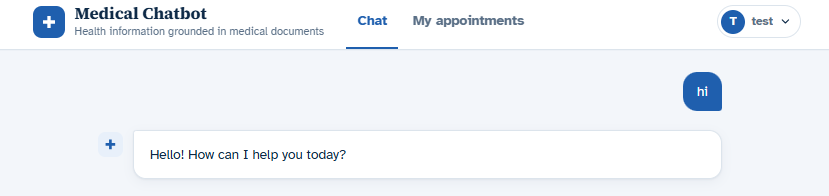</td>
  <td width="50%" valign="top"><b>Answer from documents, with sources</b><br>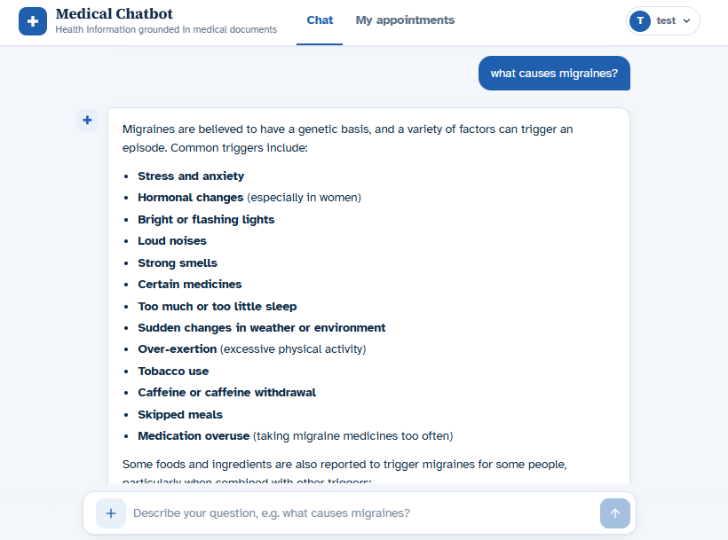</td>
</tr>
<tr>
  <td width="50%" valign="top"><b>Follow-up question</b><br>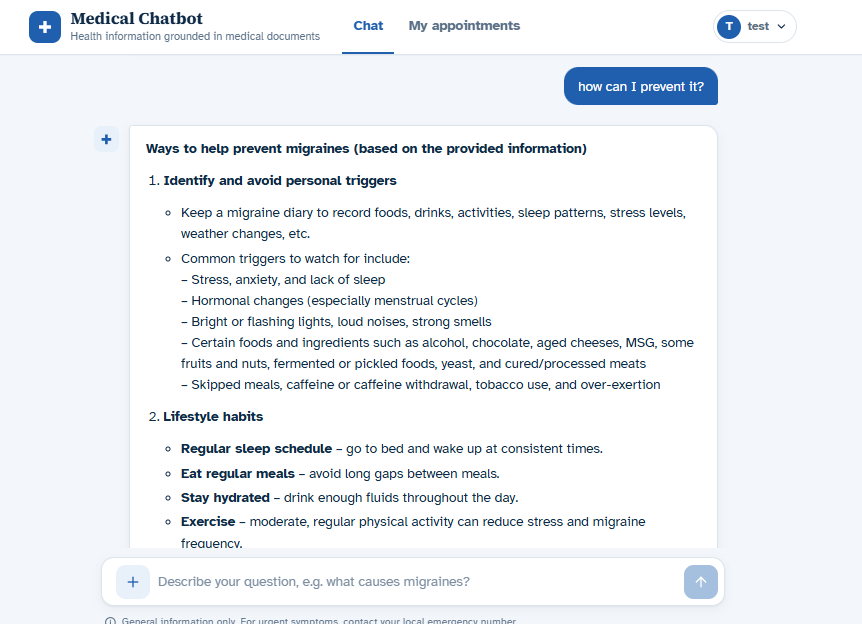</td>
  <td width="50%" valign="top"><b>Roman Urdu answer</b><br>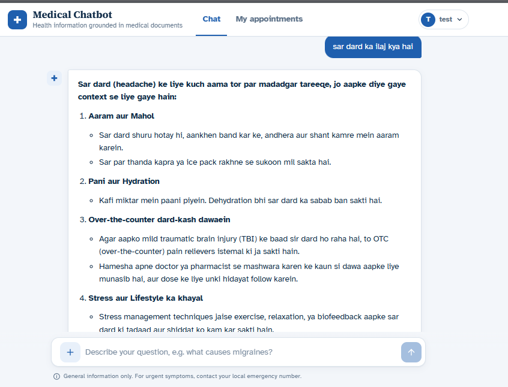</td>
</tr>
<tr>
  <td width="50%" valign="top"><b>Off-topic question</b><br>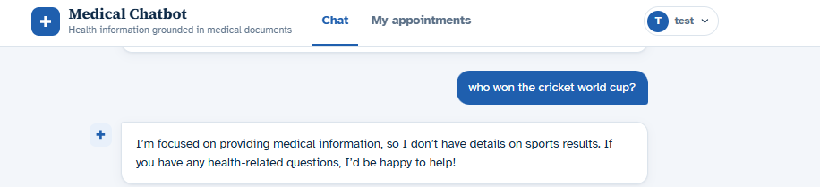</td>
  <td width="50%" valign="top"><b>General answer notice</b><br>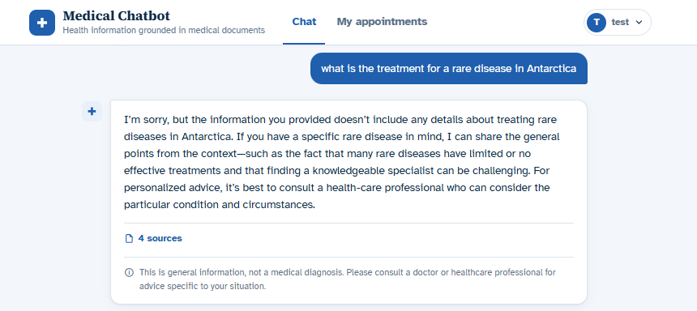</td>
</tr>
</table>

### Safety

<table>
<tr>
  <td width="50%" valign="top"><b>General question, no alarm</b><br>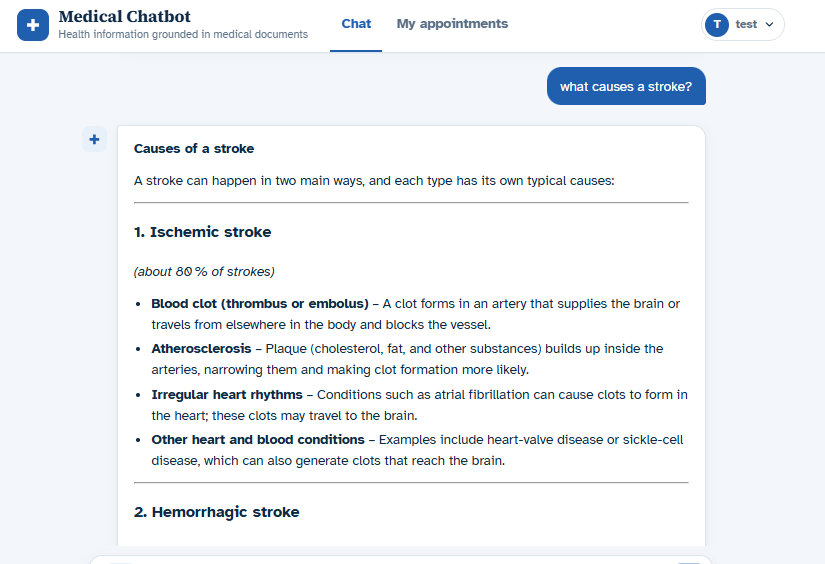</td>
  <td width="50%" valign="top"><b>Emergency message</b><br>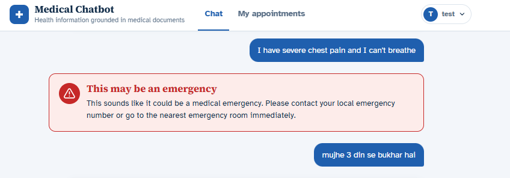</td>
</tr>
<tr>
  <td colspan="2" align="center"><b>Emergency during the symptom intake</b><br>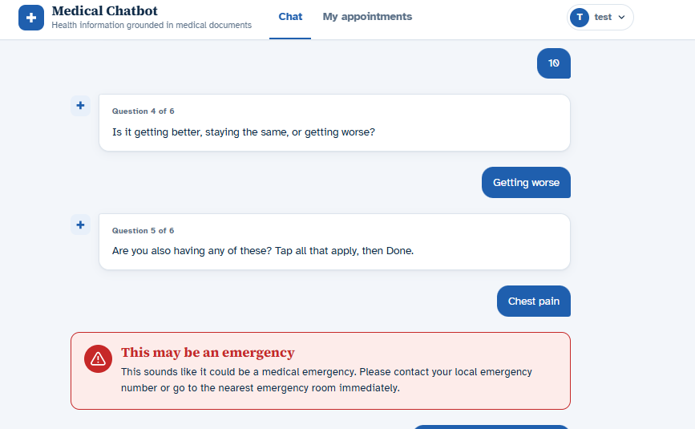</td>
</tr>
</table>

### Symptom intake and doctor suggestion

<table>
<tr>
  <td width="50%" valign="top"><b>First intake question</b><br>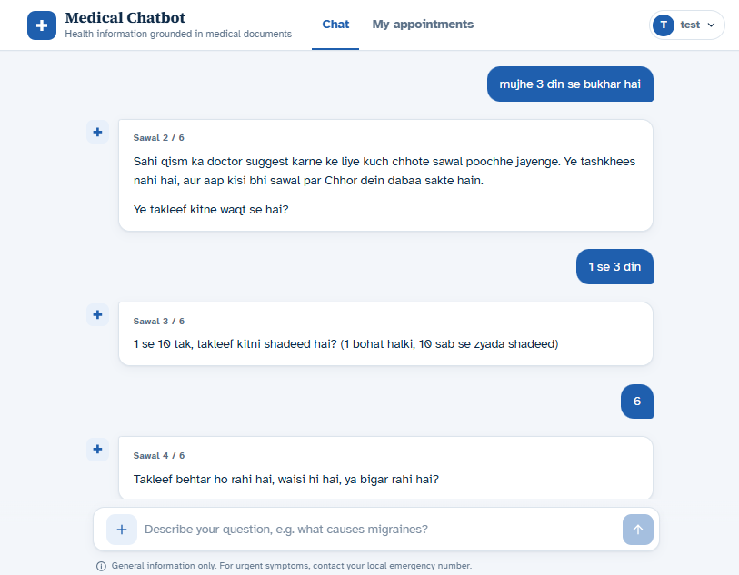</td>
  <td width="50%" valign="top"><b>Result with urgency and doctors</b><br>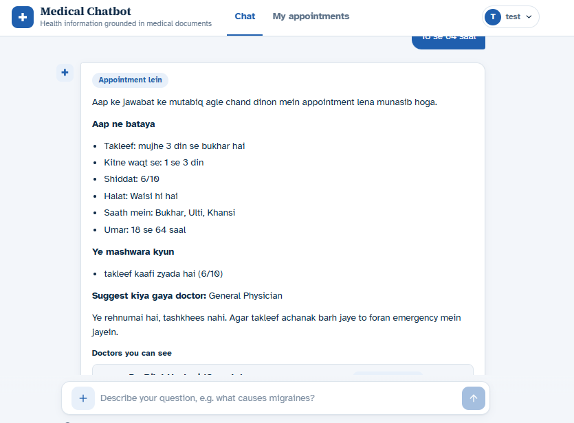</td>
</tr>
<tr>
  <td colspan="2" align="center"><b>Stopping the intake</b><br>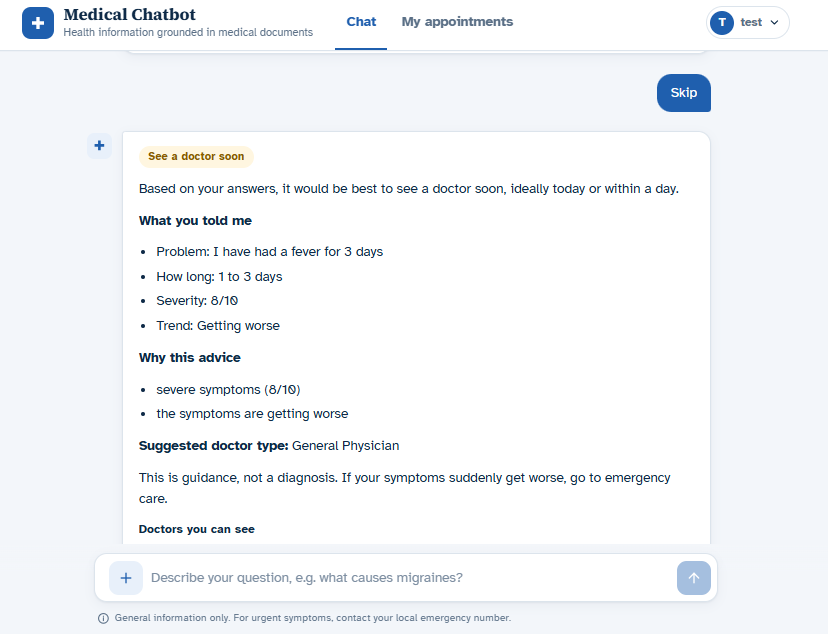</td>
</tr>
</table>

### Accounts and booking

<table>
<tr>
  <td width="50%" valign="top"><b>Booking a slot</b><br>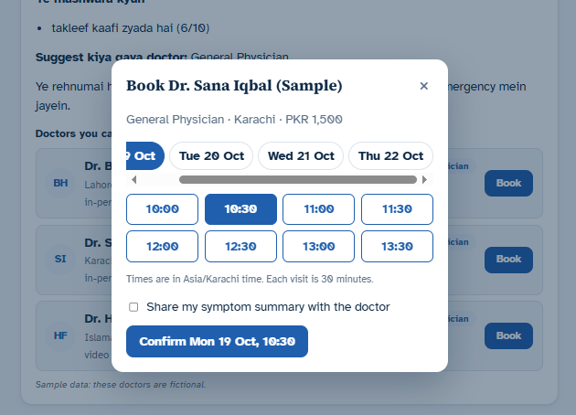</td>
  <td width="50%" valign="top"><b>My appointments</b><br>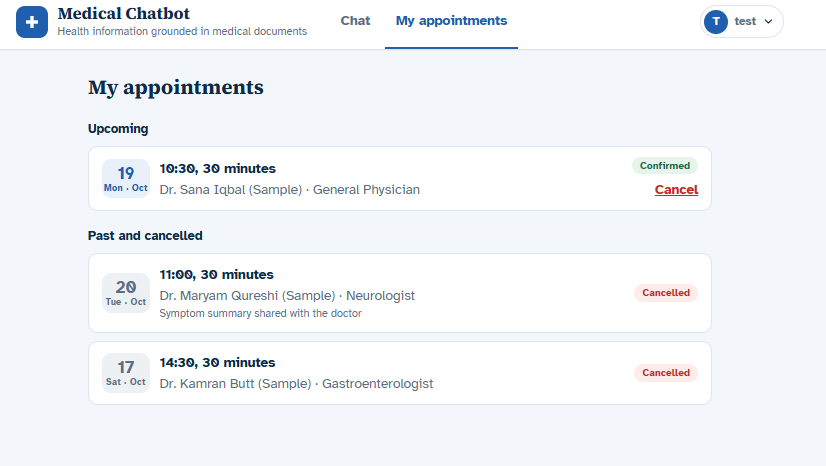</td>
</tr>
<tr>
  <td colspan="2" align="center"><b>Account menu</b><br>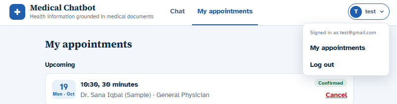</td>
</tr>
</table>

---

## How it works

```
Browser ──POST /chat──▶ Router (one LLM call)
                          │  intent, language, standalone English query, urgency
                          ▼
                 Safety check ──emergency──▶ fixed emergency message
                          │
          ┌───────────────┼──────────────────────┐
          ▼               ▼                      ▼
   Symptom intake   Small talk /            Medical question
   (MongoDB state,  off-topic reply             │
    one question)                               ▼
          │                         Qdrant search (top 6)
          ▼                                     │
   Urgency rules + doctor type                  ▼
   + doctor cards                   Relevant passages?
                                     ├─ yes ──▶ answer from documents + sources
                                     └─ no  ──▶ labelled general answer
```

1. The browser sends the message to `POST /chat`, together with a session ID.
2. The **router** makes one LLM call and returns the intent (`medical`, `symptom`, `chitchat` or `off_topic`), the language, a standalone English query and an urgency level.
3. The **safety check** uses emergency phrases from `red_flags.json`, regex filters and the router's urgency. An emergency ends the flow here.
4. For a **symptom**, the intake starts or continues. Its state (answers, step and status) is stored in MongoDB for each chat session.
5. For a **medical question**, Qdrant returns the closest passages. Only passages with a score of at least 0.5, and close to the best match, are used. They go to the LLM together with the question and recent history.
6. **Booking** identifies the user from the JWT token. Free slots are calculated from each doctor's weekly schedule in the clinic time zone.

---

## Tech stack

| Layer | Technology |
|---|---|
| Backend API | FastAPI, Pydantic, Uvicorn |
| Language model | Groq (`openai/gpt-oss-120b`) via LangChain |
| Retrieval | Qdrant Cloud (vector search), fastembed (`BAAI/bge-small-en-v1.5`, runs locally) |
| Database | MongoDB Atlas (chat history, intake state, users, doctors, appointments) |
| Authentication | JWT (PyJWT), scrypt password hashing (Python standard library) |
| Frontend | React, Vite, react-markdown |
| Data | MedlinePlus Health Topics XML (National Library of Medicine) |

---

## Project structure

```
backend/
├── app/
│   ├── main.py              application setup: routers, CORS, startup checks
│   ├── api/                 routes (chat, health, accounts, booking) and schemas
│   ├── auth/                password hashing, JWT tokens, current-user dependency
│   ├── booking/             slot calculation, booking rules, appointment data access
│   ├── chains/              router, answer chain and prompts
│   ├── intake/              symptom intake: flow, rules, texts, doctor lookup, state store
│   ├── rag/                 vector store, MedlinePlus ingestion, debug search
│   ├── safety/              emergency phrases and helpers
│   ├── core/                settings, rule loader and consistency checks
│   ├── db/                  MongoDB connections
│   └── data/
│       ├── rules/           red_flags.json, specialties.json, intake_questions.json
│       ├── doctors/         doctors.json (fictional)
│       └── medlineplus/     mplus_topics.xml (downloaded, not in git)
├── check_batch2.py          end-to-end test: chat and intake
├── check_batch3.py          end-to-end test: accounts and booking
└── requirements.txt

frontend/
├── src/
│   ├── App.jsx              layout, header, navigation, views
│   ├── api.js               backend calls (chat, accounts, booking)
│   ├── auth/                login state shared across the app
│   ├── components/          messages, sources, intake buttons, doctor cards,
│   │                        booking dialog, login form, account menu
│   ├── hooks/useChat.js     chat state and session handling
│   └── pages/Appointments.jsx
├── vite.config.js           development proxy to the backend
└── package.json
```

---

## Running the project locally

**Prerequisites**
- Python 3.12 or newer
- Node.js 20.19 or newer
- Accounts for Groq, Qdrant Cloud and MongoDB Atlas, with their keys and connection strings

The project uses two terminals: one for the backend, one for the frontend.

### Terminal 1: backend

```bash
cd backend

# 1. Create and activate a virtual environment
python -m venv venv
source venv/bin/activate          # Windows: venv\Scripts\activate

# 2. Install the dependencies
pip install -r requirements.txt

# 3. Start the API server
uvicorn app.main:app --reload
```

The server runs at `http://127.0.0.1:8000`. API documentation is available at `http://127.0.0.1:8000/docs`.

The first time, you also need to load the data once (in another terminal, with the virtual environment activated):

```bash
cd backend
python -m app.rag.ingest_medlineplus    # loads the medical documents into Qdrant
python -m app.db.seed_doctors           # loads the sample doctors into MongoDB
```

### Terminal 2: frontend

```bash
cd frontend

# 1. Install the dependencies (first time only)
npm install

# 2. Start the development server
npm run dev
```

Open `http://localhost:5173` in your browser. The development server forwards all API calls to the backend, so no extra configuration is needed.

### Stopping the servers

Press `Ctrl+C` in each terminal.

---

## Testing

Start the backend first, then run these in a third terminal:

```bash
cd backend
source venv/bin/activate

python check_batch2.py    # chat, documents, emergencies, symptom intake
python check_batch3.py    # sign-up, login, slots, booking rules, cancellation
```

Each check prints `PASS` or `FAIL`. The booking script creates test accounts (`check-...@example.test`) and cancels its test appointments when it finishes.

---

## API reference

| Method | Path | Login | Description |
|---|---|---|---|
| GET | `/health` | no | Server status |
| POST | `/chat` | no | Send a message; returns an answer, an intake question or doctor cards |
| DELETE | `/chat/{session_id}` | no | Clear a chat and its symptom intake |
| POST | `/auth/signup` | no | Create an account; returns a token |
| POST | `/auth/login` | no | Log in; returns a token |
| GET | `/auth/me` | yes | The logged-in user |
| GET | `/doctors/{doctor_id}/slots` | no | Free 30-minute slots for the next 7 days |
| POST | `/appointments` | yes | Book a slot (optionally share the symptom summary) |
| GET | `/appointments/me` | yes | My upcoming and past appointments |
| POST | `/appointments/{id}/cancel` | yes | Cancel my appointment |

---

## Safety design

- **Layered checks.** Emergency phrases are checked before any model call. The router's urgency is checked next. The intake also runs a red-flag check after every answer.
- **No diagnosis and no dosage.** The prompts forbid naming a condition for the user and giving medicine doses. Sensitive questions receive an extra rule.
- **Grounded answers.** Answers are built only from retrieved passages. Low-scoring matches are not used.
- **Privacy.** Passwords are never stored in plain text or returned by the API. Each patient can see only their own appointments. A symptom summary is shared with a doctor only if the patient ticks the box, and only after a finished intake.
- **Honest fallback.** When nothing relevant is found, the answer says so and is labelled as general information.

---

## Data sources and attribution

- **Health topics:** [MedlinePlus.gov](https://medlineplus.gov/), National Library of Medicine. Answers that use this content are marked "Information from MedlinePlus.gov".
- **Doctors, specialties, fees and schedules:** fictional sample data created for this project.
- **Red-flag phrases and intake rules:** simple demonstration rules written for learning. They are not clinical guidelines and must be reviewed by a clinician before any real use.

---

## Limitations

- The embedding model works best in English, so Roman Urdu questions can be less accurate.
- Only one document source (MedlinePlus) is loaded.
- Free-tier hosting may sleep and respond slowly on the first request.
- Doctor availability comes from a weekly schedule. Rescheduling and payments are not supported.
- There are no email or SMS reminders yet.
- Login tokens are stored in the browser's `localStorage`. This is acceptable for a learning project, but a production system should use a more secure approach such as HTTP-only cookies.
- This is not a medical device and must not be used with real patients.

---

## Roadmap

- Doctor accounts and a doctor dashboard that shows the patient's symptom summary
- An admin page with charts: frequent questions, knowledge gaps and urgency counts
- Email reminders for appointments
- An evaluation set (questions with expected sources) to measure retrieval and answer quality
- Support for Urdu-script questions and a multilingual embedding model

---

## Author

**Laiba**. Built as a portfolio project to explore retrieval-augmented generation, safety design and full-stack development.
```

